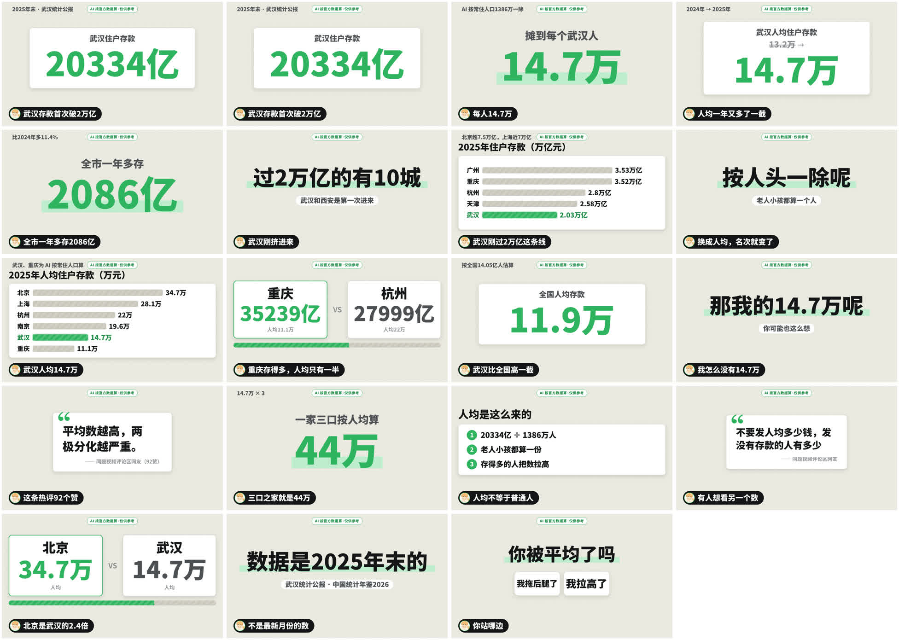
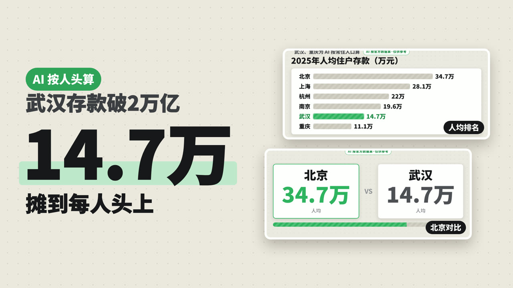

# douyin-hot-agent：短视频热点追踪 Agent

热点一出，它自动做出一条视频。

跟 AI 说一句「今天追个热点」，它会：拉抖音热榜 → 挑出值得做的题 → 拆同题爆款和评论区 → 查数写稿（每个数都要有出处）→ 渲染成能直接发的 mp4 → 出封面、标题、简介。发布由你自己来。

一共 7 个 skill：`hot-agent` 是总指挥，按顺序调用另外 6 个；这 6 个也都能单独用（比如只拿 `hot-script` 写稿）。

| 文件夹 | 做什么 | 产出 |
|---|---|---|
| `hot-agent` | 总指挥：按顺序跑下面 6 步，记流水账，该停的时候停下来问你 | `agent-log.md` |
| `hot-topics` | 抓热点：拉抖音热榜，滤掉不能碰的（时政、军事、事故通报……），按你账号的方向挑 5–8 个 | `hot.md`、`shortlist.md` |
| `hot-score` | 值不值得做：去抖音搜同题，看谁已经做了、做到多少赞，按热度 / 空位 / 好看 / 争议 / 做得完打分 | `score.md`、`pick.json` |
| `hot-breakdown` | 拆同题爆款：开头几秒说了什么、节奏、结构，评论区在吵什么 | `breakdown.md`、`brief.md` |
| `hot-script` | 查事实 + 写稿：每个数都要找到出处，找不到就不写；写完自己再检查一遍 | `facts.json`、`script.md` |
| `hot-render` | 出画面：数据面板式的横屏（或竖屏）视频，字幕、节奏音乐都带上，先出定格图自查再渲染 | `video.mp4` |
| `hot-publish` | 封面 + 标题 + 简介：三个尺寸的封面，抖音 / 小红书 / B 站各自的标题和简介，检查字数和敏感词 | `covers/`、`publish.md` |

## 一次真跑长什么样

2026-11-07 这次：热榜 140 条，划掉 7 条不能碰的，挑出 7 个题。热搜第一的「立冬吃什么」在「还有没有空位」只得了 5 分（同题已经有八万多赞的），最后挑了「武汉存款破 2 万亿」，算了摊到每个人头上是多少。成片 45 秒，渲染约一分半钟；数据接口费约 0.15 美元（模型的钱另算）。

定格图（渲染前它自己一张张看过）：

封面（网页排字，不会有错字；右边是成片里的两张画面）：

## 安装

把 7 个 `hot-*` 文件夹**一起**拷进你用的工具的 skills 文件夹（放在同一层，它们会互相调用）：

| 工具 | skills 文件夹 |
|---|---|
| Claude Code | `~/.claude/skills/` |
| Codex | `~/.codex/skills/` |
| WorkBuddy | `~/.workbuddy/skills/` |

目前只在 Claude Code 里全自动跑通过；Codex、WorkBuddy 用的是同一套 `SKILL.md`，还在测。

还要准备：

- 环境变量 `TIKHUB_API_KEY`：抖音热榜、搜索、播放数走 [TikHub](https://tikhub.io) 的付费接口，用你自己的密钥。**别把密钥贴进对话**，设成环境变量就行。
- Python 3、Node 22 以上、Chrome（或 Edge）。ffmpeg 没有会自动装。

## 用

新建一个文件夹当工作文件夹，在里面对 AI 说：

> 今天追个热点

第一次会一次性问你几个问题（账号做什么内容、什么题不碰、抖音昵称、横屏还是竖屏、要不要旁白），记进 `热点/profile.md`，以后不再问。

跑法有两种：**全自动**（默认，只在必须停的地方停）和**每步看一眼**（每步做完给你看要点，你说「继续」再往下）。中途断了，说「继续做今天那条」会从断的地方接着做。

产出都在 `热点/今天日期/`：`video.mp4`、`covers/`、`publish.md`。

它会停下来问你的情况：今天没有一个热点值得做；题有风险（政策、未成年人、饭圈）；缺关键数据讲不通；接口费明显超出正常。

## 注意

- 它不会替你发布。发的时候记得勾选「内容由 AI 生成」。
- 标题和标签会避开「预测」「竞猜」这类容易不过审的词，但最终能不能过审以平台为准。
- 片子里每个数都在 `facts.json` 里有出处；拿不准的会写进 `script.md` 的「没核实的」，发之前看一眼。
- 本项目和抖音、TikHub 都没有关系。抖音数据按 TikHub 的条款使用，别拿去转售。

## 许可

MIT
